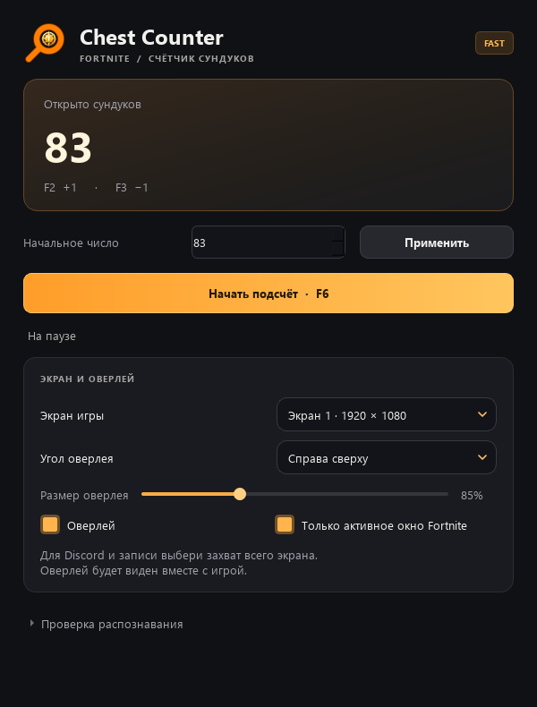

# Chest Counter · Fast

Локальный счётчик открытий сундуков Fortnite для Windows. Распознаёт уведомление опыта: сумму **«+ число ОП / XP»** и подпись **«СУНДУК / CHEST»** под ней.



## Возможности

- OCR небольшой области экрана; модели включены в репозиторий, распознавание работает без интернета.
- Ручная коррекция числа и глобальные клавиши без Ctrl/Alt.
- Оверлей с подписью и числом: верхний левый или правый угол, масштаб 60–140%, пропуск кликов.
- Оверлей доступен для демонстрации и записи всего экрана.
- Сохранение счётчика и настроек между запусками.
- Тёмный интерфейс с оранжево-золотыми акцентами.

Версия Fast анализирует только уведомления XP. Звук, инжект, чтение памяти игры и игровые нажатия не используются.

## Управление

| Клавиша | Действие |
| --- | --- |
| F2 | Добавить 1 |
| F3 | Убрать 1 |
| F6 | Автоподсчёт / пауза |

Для установки числа введи его в поле «Начальное число» и нажми «Применить». Удержание горячей клавиши не вызывает повторных срабатываний.

## Запуск из исходников

Нужны **Windows x64 и Python 3.14 x64**. Команды PowerShell из корня репозитория:

```powershell
python -m venv .venv
.\.venv\Scripts\python.exe -m pip install -r source\requirements.txt
.\.venv\Scripts\python.exe source\launcher_xp.py
```

Актуальная точка входа — `source/launcher_xp.py`. Перед запуском закрой предыдущий экземпляр приложения.

Если используешь готовую Windows-сборку, распакуй её полностью и запускай `ChestCounterXP.exe`. Папка `_internal` должна оставаться рядом. EXE и ZIP не входят в исходники; их можно прикладывать отдельно к GitHub Releases.

## Настройка и Discord

1. Выбери экран игры и положение оверлея.
2. Используй оконный режим Fortnite без рамки.
3. Нажми «Начать подсчёт» или F6 и вернись в игру. По умолчанию OCR работает только при активном окне Fortnite.
4. Для Discord выбери **весь экран** с игрой и оверлеем. В OBS используй **«Захват экрана»** того же монитора. Захват одного окна игры может не включать отдельное окно оверлея.

Область XP по умолчанию рассчитана по образцу 1919 × 1079 и масштабируется относительно экрана. Если HUD отличается, открой «Проверка распознавания» → «Выбрать область» и выдели обе строки уведомления. После изменения области или экрана снова включи автоподсчёт. Масштаб, угол и видимость оверлея меняются без остановки подсчёта.

## Ограничения

Для зачёта нужны два положительных чтения подряд. Одно непрерывное уведомление учитывается один раз; несколько открытий, объединённых игрой в одно уведомление, могут пропускаться. Другая награда XP без подписи сундука не учитывается. Сумма опыта не фиксирована.

Пройдены девять тестов распознавания и логики, самотест собранного EXE и отдельная проверка захвата оверлея Windows. Это не проверка точности на непрерывном матче или в звонке Discord. Влияние на FPS в игре не измерено; гарантий совместимости с античитом нет.

## Данные

Настройки и число хранятся в `%LOCALAPPDATA%\ChestCounter\settings.json`, ошибки запуска — в `error.log` в той же папке. Самотесты используют временный каталог и не меняют личный счётчик. OCR обрабатывает изображение локально.

## Структура проекта

```text
source/
  launcher_xp.py         запуск и самотесты
  xp_app.py              интерфейс, горячие клавиши, поток OCR
  xp_detector.py         проверка награды и защита от дублей
  minimal_ui.py          оформление и оверлей
  app.py                общие компоненты, включая выбор области
  detector.py           зависимости общих компонентов
  signals_engine.py     общий OCR-класс XPReader
  assets/               лого и стрелка интерфейса
  models/               две локальные ONNX-модели
  fixtures/chest_xp.png  тестовый фрагмент уведомления
  test_xp.py             тесты
  ChestCounterXP.spec    сборка PyInstaller
  requirements.txt      закреплённые зависимости
docs/                   сборка, происхождение моделей, превью
```

В общих модулях остался код ранних версий. Он не включает звуковой детект в Fast. Эти файлы сохранены из-за импортов; запускать старый `app.py` вместо `launcher_xp.py` не следует.

Подробнее: [сборка и тесты](docs/BUILD.md), [сторонние компоненты и модели](docs/THIRD_PARTY.md).

## Подготовка к публикации

`.gitignore` использует список разрешённых файлов: локальные сборки, архивы, окружения, кэши, настройки, отчёты и документы передачи контекста исключены. Перед коммитом проверь `git status --short` и `git diff --cached --stat`. Новые публичные файлы нужно явно добавить в разрешённый список.

Лицензия собственного кода проекта пока не выбрана. Лицензия Apache-2.0 в `docs/licenses/` относится к сторонним OCR-компонентам и моделям, а не ко всему проекту. Проект не является официальным продуктом Epic Games.
